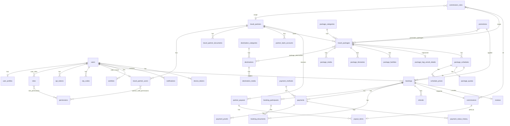

# ERD - MultiTravel (MySQL 8)

Render dengan Mermaid (GitHub, VS Code, mermaid.live).

## Tabel mandiri
`settings`, `banners`, `articles`, `faqs`, `audit_logs`, `rate_limits`, `webhook_logs`.

## Konsep kunci
- **Kuota:** `quota_available = total - held - booked`. Booking pending menaikkan `held`; setelah DP/lunas, `held` pindah ke `booked`; kedaluwarsa/batal mengurangi `held`/`booked`.
- **Snapshot:** `bookings` (harga, diskon, DP, nama paket/travel), `booking_participants.unit_price`, `commissions` (aturan + hasil hitung).
- **Isolasi tenant:** `travel_partner_id` ada di `travel_packages`, `package_schedules`, `bookings`, `payments`, `refunds`, `commissions`, `partner_payouts`, `reviews`.
- **DP & pelunasan:** `payments.kind` = `full` | `dp` | `settlement`; saldo di `bookings.paid_amount` / `remaining_amount`.
